# SR → 사람 ReID: 초해상도는 재식별 성능을 올리는가

저해상도 보행자 이미지를 초해상도(SR)로 키웠을 때, 같은 크기로 단순 확대(bicubic)한 경우보다 사람 재식별(ReID) 성능이 좋아지는지 검증한 개인 연구. 직전 프로젝트 rs-sr-detect(위성영상 SR → 건물 탐지)의 후속이며, **SR의 가치는 화질 점수가 아니라 다운스트림 과제 성능으로 판단함**이라는 같은 원칙을 따름.

---

## 핵심 결과

| | 내용 |
|---|---|
| **결론** | SR이 ReID를 일관되게 개선한다는 근거 없음. 효과는 모델에 따라 갈리고, 크기는 대부분 ±0.7%p 이내 |
| **판정 24건** | useful 6 · harmful 6 · inconclusive 12 (mAP, 신원 단위 부트스트랩 95% CI) |
| **유일하게 일관된 개선** | BoT(ResNet-50)에서 생성형 SR이 도움. OSDHuman ×4 **+1.55%p**, ×3 +0.73%p, PiSA-SR ×4 +0.57%p |
| **가장 큰 발견** | 학습과 test의 화질 조건이 어긋나면 성능 급락. BoT를 OSDHuman 이미지로 학습한 뒤 bicubic test에 쓰면 mAP **−74%p**. 손실 크기는 Stage 1의 "원본에서 벗어난 정도" 순서와 16개 조합 중 15개에서 일치 |
| **화질 지표의 예측력** | query 단위로 Stage 1 지표와 ReID 이득의 상관은 대부분 \|ρ\| < 0.1. 화질 지표로 ReID 효과를 미리 고르기 어려움 |
| **주의** | seed 1개. 크게 튄 판정 4건(+3.3~+4.2%p, −5.2%p)은 약하게 수렴한 학습 2개와 겹쳐 SR 효과로 해석 불가 |

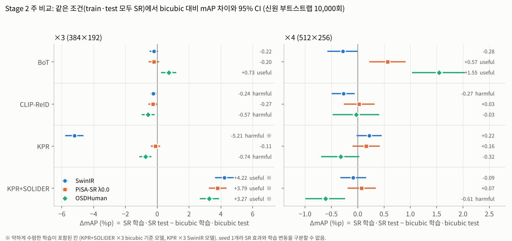

---

## 1. 개요

### 1.1 연구 질문

- **주 질문:** 원본 128×64 보행자 이미지를 SR로 ×3·×4 확대해 학습·평가하면, 같은 배율의 bicubic 확대보다 ReID mAP가 높은가
- **부 질문:** SR 품질 지표(원본 보존, 화질, 주파수)가 ReID 효과를 예측하는가

### 1.2 설계 원칙 (rs-sr-detect에서 계승)

- SR 방법은 PSNR 같은 화질 점수가 아니라 **ReID 성능**으로 평가
- 비교는 항상 **같은 배율의 bicubic 대비**(입력 크기·연산량을 맞춘 대조군)
- 신원 단위 부트스트랩 CI로 **useful / harmful / inconclusive** 판정
- test는 선정 단계에서 사용 금지. 최종 평가 전까지 `data/locked`에 잠금(권한 000)
- 모든 이미지·가중치의 SHA256 기록, 비트 단위 재현성 확인

### 1.3 이 설계가 답하는 범위

Market-1501 원본은 고화질을 열화시킨 이미지가 아니라 **원래 저해상도**인 이미지임. 따라서 이 연구는 "사라진 디테일을 복원하는가"가 아니라 **"입력을 키우는 방식 중 무엇이 ReID에 유리한가"**에 답함. 정답 고화질 이미지가 없으므로 Stage 1의 모든 품질 지표는 원본과의 관계만 측정함.

---

## 2. 연구 과정: 무엇을 확인하려 했고, 어떤 한계를 어떻게 풀었나

설계는 처음부터 고정되지 않았음. 파일럿과 단계별 측정 결과, 그리고 연구자와 AI 조수(Claude) 간 설계 논의를 거치며 여러 번 바뀜. 아래는 각 결정에서 **확인하려던 것 → 부딪힌 한계 → 해결 방법**의 기록.

### 2.1 확인하려던 질문과 답한 단계

| 질문 | 답한 단계 |
|---|---|
| SR이 같은 배율의 bicubic보다 ReID를 올리는가 | Stage 2 주 비교 |
| 어떤 성격의 SR(원본 보존형 / 디테일 생성형)이 유리한가 | Stage 1로 성격 분류 → Stage 2에서 성격이 다른 3종 비교 |
| 학습과 test의 화질이 다르면 어떻게 되나 (배포된 모델 앞에 SR만 붙이는 상황) | Stage 2 2×2의 나머지 칸 |
| 정답 없는 품질 지표가 ReID 효과를 예측하는가 | 사후 분석의 query 단위 상관 |
| 관찰한 차이가 파이프라인 오류가 아닌 실제 효과인가 | Stage 0.5의 재현·등가성 검증 |

### 2.2 문제 설정

| 결정 | 확인하려던 것 | 부딪힌 한계 | 해결 |
|---|---|---|---|
| 저해상도의 정의 | SR이 사라진 정보를 복원해 ReID를 돕는가 | 파일럿은 원본을 ×4 축소(32×16)한 합성 LR을 썼으나, 이 크기에서는 SR이 복원이 아니라 생성에 가깝고 합성 열화는 실제 열화와 다름. 사람 ReID에는 실제 LR–HR 쌍 데이터도 없음 | 원본 128×64를 저해상도로 보고 **키우는 문제**로 재정의. 합성 축소를 쓰지 않는 대신 주장 범위를 "입력을 키우는 방식 비교"로 한정 |
| 학습 조건 | SR 입력이 ReID에 주는 효과 | rs-sr-detect처럼 HR 학습 모델을 고정하고 SR 입력만 넣으면 SR 효과와 도메인 차이가 섞임 | train·test를 같은 조건으로 학습하는 C_k / S_k 비교를 주 비교로. 도메인 차이는 2×2의 나머지 칸(train만 SR, test만 SR)으로 분리 측정 |
| 배율 | 확대 정도에 따른 효과 | ×2(256×128)는 모델 표준 입력이라 이미 bicubic ×2로 학습된 공개 결과와 같은 조건 | ×3·×4만 실험, ×2는 공개 가중치 기준선으로 대체 |
| ReID 모델 4종 | SR 효과가 모델 성격에 따라 달라지는가 | 모델 하나로는 결과가 그 모델의 특성인지 알 수 없음 | 성격이 다른 백본 4종: CNN(BoT), 언어–이미지 사전학습(CLIP-ReID), 키포인트 파트 모델(KPR), 사람 자기지도 사전학습(KPR+SOLIDER) |
| KPR 키포인트 | 배율이 바뀌어도 같은 키포인트 정보 사용 | SR 이미지에서 다시 검출하면 검출기 차이가 결과에 섞임 | 원본 키포인트를 픽셀 중심 규약 `(x+0.5)·k−0.5`로 스케일. 오차 0 확인 |
| seed | 학습 변동의 크기 | 32회 학습 × seed 추가는 비용이 배로 늘어남 | seed 42 하나로 고정하고 한계로 명시. **결과적으로 약하게 수렴한 학습 2개가 판정 4건을 좌우해 해결하지 못한 한계로 남음**(9절) |

### 2.3 test 누출 방지

| 확인하려던 것 | 부딪힌 한계 | 해결 |
|---|---|---|
| SR 선정과 설정을 test 결과에 맞추지 않음 | 작업 에이전트가 실수로 test를 읽을 수 있음. KPR·CLIP-ReID 공식 데이터 클래스는 생성 시 query·gallery를 자동으로 읽음 | test 폴더를 `data/locked`에 격리하고 권한 000, 경로 검사와 audit hook 가드(`ALLOW_TEST=1`일 때만 허용). train만 넘기는 어댑터로 공식 로더 대체. 잠금 해제·재잠금은 연구자가 직접 하고 `logs/test_access.log`에 기록. 평가 중간 결과를 봐도 남은 학습 계획은 바꾸지 않음 |

### 2.4 파이프라인 검증 (Stage 0·0.5)

결과를 해석하기 전에, 결과를 만드는 도구부터 믿을 수 있는지 확인함.

| 확인하려던 것 | 부딪힌 한계 | 해결 |
|---|---|---|
| RTX 4090 한 장으로 가능한 범위 | KPR ×3·×4는 gradient checkpointing을 켜도 배치 64에서 메모리 부족 | 배치를 줄이면 학습 레시피가 바뀌므로 배치 64 유지. 필요 VRAM을 외삽해 A100 80GB로 이동 |
| 평가 코드가 공식과 같은가 | KPR 공식 평가는 RAM 피크 약 128GiB(이미지·마스크를 계속 쌓는 구조) | 특징만 남기는 스트리밍 평가기 작성. 공식과 AP·CMC 차이 1e-16 확인 후 사용, RAM 15GiB |
| 학습 가속(memmap 캐시)이 결과를 바꾸지 않는가 | 결정론 모드 200 iteration 비교에서 BoT·KPR 계열 불합격 | BoT: GPU 정규화의 반올림 차이 → CPU 워커 정규화로 복귀. KPR: 원인 추적 중 **공식 로더 버그 발견**(`lru_cache`가 같은 배열을 돌려주고 BIPO 증강이 그 배열을 제자리 수정해 데이터 오염) → 반환값만 복사하는 copy_read 로더를 기준으로 채택하고 공식 대비 변경점으로 기록. 이후 4종 모두 loss 비트 일치 |
| KPR 마스크 저장 형식 | uint8로 저장하면 값이 깨져 iteration 0부터 loss가 달라짐 | float32로 확정 |
| 구현 전체가 정상인가 | — | 공개 가중치 4종이 논문 수치와 0.1%p 이내로 재현됨을 확인 |

### 2.5 Stage 1 설계: 정답 없이 SR을 어떻게 비교하나

가장 많이 바뀐 부분. 처음에는 **train을 651/100명으로 나눠 12종 모두 BoT·CLIP-ReID로 학습하고 검증 mAP로 순위를 매기는 안**이었으나, 약 240 GPU시간이 들고 seed 1개라 순위를 믿기 어려워 취소함. 대신 ReID 학습 없이 SR 결과 자체를 비교하는 방식으로 바꾸고, 그 과정에서 지표를 다음과 같이 다듬음.

| 부딪힌 한계 | 해결 |
|---|---|
| 정답 고화질 이미지가 없음 | 모든 지표를 "원본 128×64 vs 실제 SR"로만 계산 |
| 원본과의 유사도는 덜 바꿀수록 높아 **bicubic이 항상 1등**. 이 값으로 순위를 매기면 "가장 bicubic에 가까운 SR"을 고르게 됨 | 유사도를 "좋음" 점수가 아니라 **얼마나 바뀌었나**를 보는 축으로 해석. "좋아졌나"는 A-FINE이 따로 담당. 같은 이유로 가중 평균 순위·파레토 같은 자동 선정 규칙은 폐기하고, 결과를 본 연구자가 직접 선정 |
| ReID 모델로 특징 보존을 재면, 공개 ReID 가중치는 Market train으로 학습돼 표본을 이미 본 상태(누출)이고 Stage 2 모델과도 겹침 | Market을 보지 않은 자기지도 모델 사용: **DINOv3**(범용, 17억 장) + **PersonViT**(LUPerson 418만 장, 사람 특화). Sapiens는 고해상도 웹 이미지로 학습돼 128×64와 분포가 달라 제외, SOLIDER는 Stage 2의 KPR+SOLIDER 백본과 겹쳐 제외, PLIP은 예비 |
| 원본을 더 줄였다가 복원해 비교하는 "보정 실험"은 실제 SR 결과가 아니라 다른 입력을 평가함 | 제외. 속성 인식 모델도 Market 학습본이라 제외 |
| DINO·ReID 모델은 화질 변화에 둔감하게 학습돼 "선명해졌나"를 재지 못함 | FFT 지표 추가: 저주파 일치도(원본 정보 유지), 고주파 추가량(새로 더한 디테일의 양), 스펙트럼 기울기·격자 피크(과샤프닝·인공 무늬) |
| 코사인 0.92가 큰 차이인지 숫자만으로는 알 수 없음 | 같은 사진 + 약한 블러·JPEG(같은 이미지 수준)과 같은 사람·다른 카메라(다른 사진 수준) 기준선을 함께 계산해 그림에 겹침. t-SNE는 설정에 따라 모양이 바뀌어 눈으로 보는 용도로만 사용 |
| 12종 × 2배율을 train 전체에 돌리면 약 31만 장 | 평균 비교에는 신원마다 3장(751명 2,250장)이면 충분. 전체 생성은 선정된 3종만 |

### 2.6 SR 생성의 재현성

| 확인하려던 것 | 부딪힌 한계 | 해결 |
|---|---|---|
| Stage 1에서 평가한 이미지와 Stage 2에서 학습한 이미지가 같아야 함 | 확산 모델은 배치 1에서도 실행마다 결과가 다름(비결정적 어텐션 커널). 배치 크기를 키우면 픽셀이 바뀌고, 중간에 재시작하면 처리 순서에 따라 결과가 달라짐 | 배치를 키우지 않음(공식 결과와 같은 배치 1). 결정적 설정 + 예열 1회 + 파일명 기반 seed로 처리 순서·GPU 번호·동시 실행과 무관하게 비트 일치. 그 덕분에 이미지를 여러 프로세스로 나눠 병렬 생성 가능. Stage 1 표본 18,000장이 Stage 2 생성본과 비트 일치 |
| ×4 전용 모델로 ×3을 만드는 방법 | 바로 ×3 생성(모델을 학습 조건 밖에서 사용)과 ×4 후 축소(격자 무늬 증가) 사이의 맞교환 | 모델을 학습 조건대로 쓰는 ×4 후 축소 선택. 격자 피크가 5~7dB 커지는 영향은 보고서에 명시 |

### 2.7 Stage 2: 빠르게 하되 결과는 바꾸지 않기

| 확인하려던 것 | 부딪힌 한계 | 해결 |
|---|---|---|
| 32회 학습을 공식 레시피 그대로 | 순서대로 돌리면 수일, 비용 증가 | 결과를 바꾸는 가속(배치 크기, AMP·TF32, torch.compile)은 금지. 결과가 같은 방법만 사용: GPU당 여러 학습 동시 실행, 가장 긴 KPR ×4부터 배치, 자동 대기열, `/dev/shm` 캐시, checkpointing 끔(켬·끔 비트 일치 확인), 평가를 학습과 겹쳐 진행 → 벽시계 55시간 |
| 판정이 결과에 맞춰지지 않게 | 결과를 보고 기준을 고르면 유리한 결론을 고르게 됨 | 판정 규칙(mAP 주 지표, CI 기준)을 평가 시작 전에 고정 |

### 2.8 실행 환경 문제

| 문제 | 해결 |
|---|---|
| 디스크 사용률 98% | 볼륨 200 → 350GB 확장, 큰 작업 전 디스크 가드 |
| 컨테이너 재시작으로 `/root` 아래 가중치와 작업 도구 소실 | 필요한 것을 모두 `/workspace`로 옮기고 `setup_after_restart.sh` 한 번으로 복구. 결정 사항과 진행 단계를 `CLAUDE.md`에 기록해 세션이 끊겨도 이어감 |
| 서버 이동(같은 4090, 다른 호스트) | 체크섬 37,793건 대조로 데이터 무결성 확인. 처리량·RAM은 새 서버에서 다시 측정하고, 결정론 비교는 같은 서버 안에서만 |
| GPU 종류 변경(4090 → A100) | 비트 재현은 같은 GPU 종류 안에서만 보장되므로 Stage 1을 A100에서 처음부터 재실행. 4090 결과는 섞지 않고 따로 보관 |
| H100·RTX PRO 6000은 구버전 PyTorch(1.13·2.0) 미지원 | 환경을 새로 만들면 검증을 처음부터 다시 해야 해서 Ampere 세대 A100 선택 |

### 2.9 사후 분석을 더한 이유

판정표만으로는 "왜 그런 결과가 나왔나"를 알 수 없어 평가 후 네 가지를 추가함. 판정은 바꾸지 않음.

- **query 단위 상관:** 부 질문(품질 지표가 ReID 효과를 예측하는가)에 대한 직접 답
- **train 표본 대 test 지표 분포:** Stage 1 표본 2,250장이 test를 대표하는지 확인
- **성공·실패 사례:** 숫자 뒤의 실제 모습 확인
- **기준선 재확인:** 평가 도중 KPR+SOLIDER 가중치 로드 방식을 고친 뒤에도 공개 기준선이 그대로 재현되는지 확인

---

## 3. 실험 설계

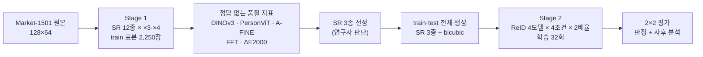

### 3.1 데이터

| 항목 | 내용 |
|---|---|
| 데이터셋 | Market-1501 (train 751명 12,936장 / query 3,368장 / gallery 19,732장) |
| 저해상도 기준 | 원본 128×64 그대로 사용(합성 축소 없음) |
| 배율 | ×3(384×192), ×4(512×256). ×2(256×128)는 BoT·CLIP-ReID의 표준 입력이라 공개 가중치 기준선으로 대체 |
| Stage 1 표본 | train에서 신원마다 3장, 751명 2,250장(seed 42). 701명은 서로 다른 카메라 3대에서 선택 |

### 3.2 SR 방법 12종

| 계열 | 방법 | 특징 |
|---|---|---|
| 보간 | bicubic, lanczos | 대조군 |
| 충실도형 SR | SwinIR, HAT, MambaIRv2 | 원본을 거의 바꾸지 않음. 공식 ×3·×4 가중치 |
| 생성형 SR | Real-ESRGAN, PiSA-SR(λ 0.0·0.5·1.0·1.5·2.0), OSDHuman | 디테일을 새로 생성. OSDHuman은 사람 특화 one-step 확산 모델 |

- ×4 전용 모델(Real-ESRGAN, PiSA-SR, OSDHuman)의 ×3은 ×4 출력을 PIL BICUBIC으로 384×192로 축소
- 확산 모델·MambaIRv2·HAT은 결정적 설정(cuDNN deterministic, SDPA math) + 예열 1회 + 파일명 기반 seed로 **비트 단위 재현** 확보

### 3.3 ReID 모델 4종

| 모델 | 백본 | 공개 가중치 기준선 mAP / R1 (공식 입력) |
|---|---|---|
| BoT | ResNet-50 (ImageNet) | 85.95 / 94.63 (256×128) |
| CLIP-ReID | CLIP ViT-B/16 | 89.66 / 95.43 (256×128) |
| KPR | Swin (ImageNet 초기화), 키포인트 프롬프트 기반 파트 모델 | 89.59 / 95.87 (384×128) |
| KPR+SOLIDER | KPR 구조 + SOLIDER 초기화(Swin, LUPerson 자기지도) | 93.25 / 96.59 (384×128) |

네 기준선 모두 논문 수치와 0.1%p 이내로 재현됨(학습하지 않은 참고 행).

### 3.4 Stage 2 평가 구조 (2×2)

학습은 조건마다 1회, 평가는 test 조건을 바꿔 4칸.

| | bicubic test | SR test |
|---|---|---|
| **bicubic으로 학습한 모델 (C)** | 기준 | test만 SR |
| **SR로 학습한 모델 (S)** | train만 SR | **주 비교** |

- **주 비교:** (S 모델 + SR test) − (C 모델 + bicubic test)
- **판정:** 신원 단위 쌍 부트스트랩 95% CI(query 신원 재표본 10,000회, seed 42). 하한 > 0이면 useful, 상한 < 0이면 harmful, 0 포함이면 inconclusive
- 주 지표 mAP, Rank-1은 보조. 나머지 두 칸은 차이와 CI만 보고

---

## 4. 실험 순서

| 단계 | 목적 | 주요 내용 | 문서 |
|---|---|---|---|
| **Phase 0 (파일럿)** | 설계 go/no-go | 합성 ×4 축소(32×16) query, HR 고정 BoT, val 100명. 구 설계로 결론에 미사용 | [PILOT_SUMMARY.md](PILOT_SUMMARY.md), [REPORT.md](REPORT.md) |
| **Stage 0** | RTX 4090 실행 가능 범위 | 모델·배율별 VRAM·속도 측정. KPR ×3·×4는 4090 불가로 판정 | [STAGE0_REPORT.md](STAGE0_REPORT.md) |
| **Stage 0.5** | 파이프라인 검증 | 기준선 재현, 공식↔경량 평가기 등가성, memmap 학습 등가성(비트 일치), KPR 키포인트·마스크 스케일 검증, KPR 공식 로더의 `lru_cache` 오염 발견·수정, 평가 RAM 128GiB → 15GiB | [STAGE05_REPORT.md](STAGE05_REPORT.md) |
| **Stage 1** | SR 기법 비교 (ReID 학습 없음) | 12종 × ×3·×4 × 2,250장 생성, 정답 없는 지표와 시각화. 순위 규칙 없이 결과만 제시 | [STAGE1_REPORT.md](STAGE1_REPORT.md), [STAGE1_REPORT.html](STAGE1_REPORT.html) |
| **선정** | Stage 2 대상 결정 | 성격이 겹치지 않는 3종: SwinIR(충실도형), PiSA-SR λ0.0(약한 생성), OSDHuman(강한 생성, 사람 특화) | [STAGE12_PLAN.md](STAGE12_PLAN.md) |
| **Stage 2** | ReID 학습·평가 | SR 3종 + bicubic으로 train·test 전체 생성(누락 0), 학습 32회, 평가 80칸, 판정 24건 | [STAGE2_REPORT.md](STAGE2_REPORT.md) |
| **사후 분석** | 해석 보강 | 기준선 재확인, test SR 품질 지표, query 단위 상관, 성공·실패 사례 | [STAGE2_ANALYSIS.md](STAGE2_ANALYSIS.md), [STAGE2_ANALYSIS.html](STAGE2_ANALYSIS.html) |

**하드웨어:** Stage 0~0.5는 RTX 4090, Stage 1~2는 A100 SXM4 80GB ×2(RunPod). 비트 단위 재현성은 같은 GPU 종류 안에서만 보장되어 Stage 1은 A100에서 처음부터 재실행함. Stage 2 학습 대기열 벽시계 55.2시간, 학습 비용 약 $198.

---

## 5. Stage 1 결과: SR 12종의 성격

### 5.1 평가 지표 (모두 "원본 vs 실제 SR", 정답 없음)

| 지표 | 측정 대상 | 좋은 방향 |
|---|---|---|
| DINOv3 ViT-L 코사인 | 이미지 전체 의미의 원본 보존 (범용 자기지도 모델) | 높을수록 원본과 가까움 |
| PersonViT ViT-B 코사인 | 사람 특징의 원본 보존 (LUPerson 자기지도, Market 미세조정 없음) | 높을수록 원본과 가까움 |
| A-FINE (CVPR 2025) | 원본 대비 충실도 + 자연스러움 | 낮을수록 좋음 |
| FFT | 저주파 일치도, 고주파 추가량, 스펙트럼 기울기, 격자 피크 | 지표별 상이 |
| ΔE2000 | 색 차이 (참고값) | 낮을수록 작음 |

해석 기준선: 같은 사진 + 약한 블러·JPEG 90의 코사인 ≈ 0.995, 같은 사람·다른 카메라 쌍의 코사인 ≈ 0.49.

### 5.2 결과: 세 무리로 분리

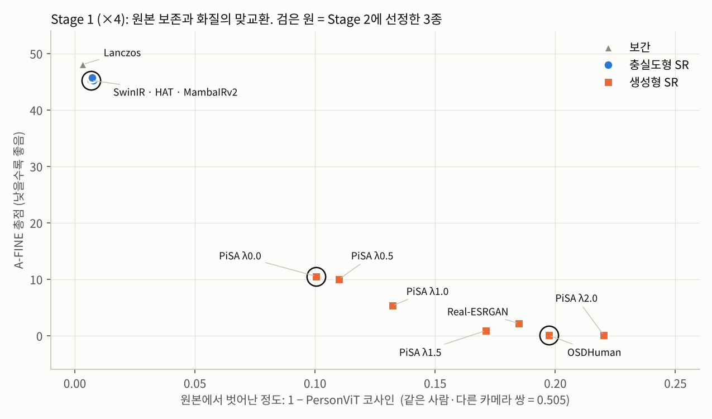

| 무리 | 방법 | 원본 보존 (PersonViT) | A-FINE (×4) | ΔE2000 | 해석 |
|---|---|---|---|---|---|
| 보간 | bicubic, lanczos | 0.997~1.000 | 48.1 (lanczos) | 0.4~0.5 | 원본 그대로 확대 |
| 충실도형 | SwinIR, HAT, MambaIRv2 | 0.991~0.993 | 45~46 | 0.07~0.12 | 원본을 거의 바꾸지 않음. A-FINE 기준 lanczos와 비슷 |
| 생성형 | Real-ESRGAN, PiSA-SR, OSDHuman | 0.78~0.90 | 0.04~10.5 | 2.3~6.0 | 크게 바꾸는 대신 훨씬 자연스러움 |

- **원본 보존과 화질은 맞교환 관계.** 원본을 덜 바꿀수록 A-FINE이 나쁘고, 많이 바꿀수록 좋음
- **충실도형 3종은 사실상 동률.** 지표 차이가 소수점 셋째 자리이며, MambaIRv2만 ×4 격자 피크 18.3dB로 전체 최고(반복 무늬 아티팩트 가능성)
- **사람 특화 모델이 보는 변화는 범용 모델보다 작음.** Real-ESRGAN은 DINOv3 기준 "다른 카메라의 같은 사람" 수준까지 멀어지지만(0.54), PersonViT 기준으로는 0.82
- **PiSA-SR λ가 커질수록** 원본 이탈·색 변화(ΔE 2.3 → 6.0) 증가, λ ≥ 1.5에서 고주파가 원본 추세를 초과(과샤프닝)
- **OSDHuman은 사람 특화 모델이지만** 사람 특징 보존(PersonViT 0.80)이 PiSA-SR λ0~1.0보다 낮음

<details>
<summary>지표별 평균과 95% CI 전체 (×4)</summary>

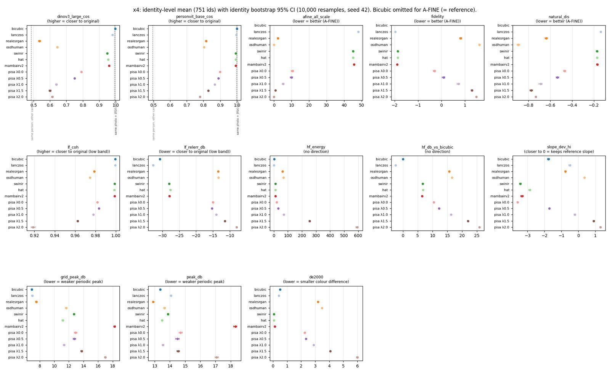

</details>

### 5.3 주파수 분석

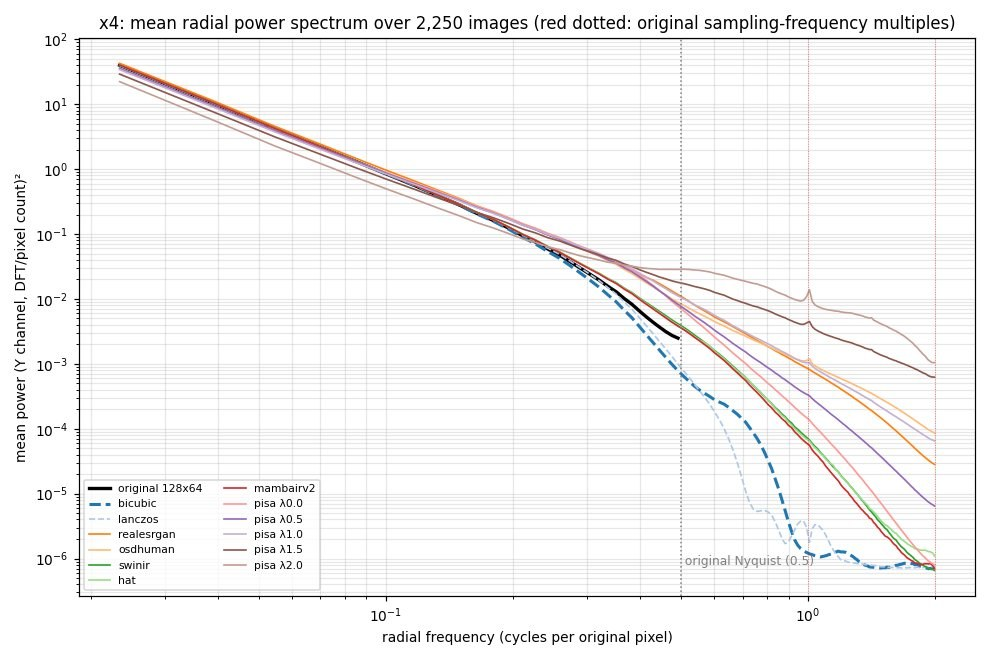

- 원본 나이퀴스트(0.5) 위에서 bicubic·lanczos는 고주파 급감(흐린 이미지)
- 충실도형은 원본 추세를 약간 이어감, 생성형은 크게 이어감
- PiSA-SR λ1.5·2.0은 원본 추세보다 많은 고주파와 표본화 주파수 배수(1.0, 2.0)의 피크 → 인공 무늬 신호

### 5.4 임베딩 분포와 실제 사진

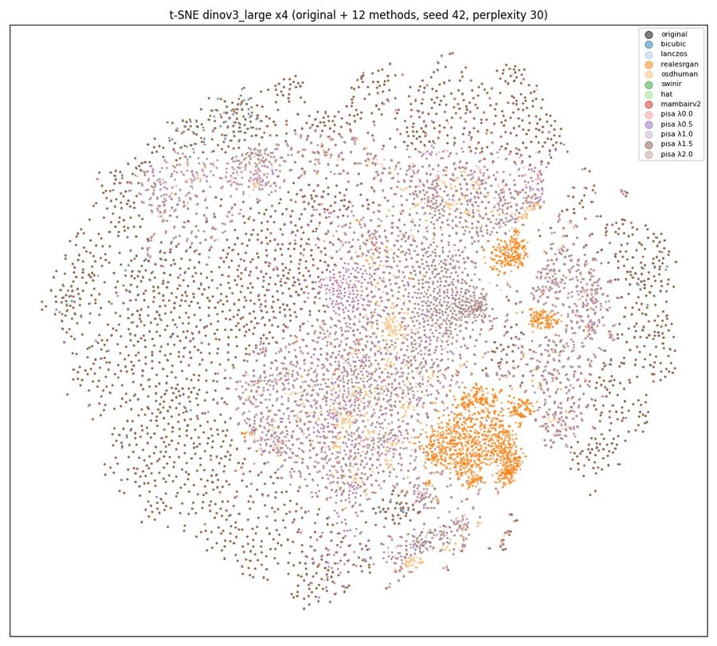

t-SNE(DINOv3, ×4): 보간·충실도형은 원본과 완전히 겹치고, Real-ESRGAN(진한 주황)은 원본 분포 밖에 별도 군집 형성. t-SNE는 국소 구조만 보존하므로 시각 확인용으로만 사용.

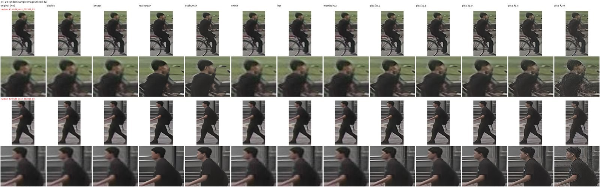

무작위 표본 비교(×4, 각 줄 아래는 얼굴·상의 확대): 왼쪽부터 원본 | bicubic | lanczos | Real-ESRGAN | OSDHuman | SwinIR | HAT | MambaIRv2 | PiSA λ0.0~2.0. 생성형은 얼굴·옷 질감을 새로 그리고, PiSA λ2.0은 노이즈성 질감이 뚜렷함.

### 5.5 Stage 2 대상 선정

| 선정 | 역할 |
|---|---|
| bicubic | 기준 |
| SwinIR | 충실도형 대표. 사람 특징 보존 1위(PersonViT 0.993, ΔE 최소) |
| PiSA-SR λ0.0 | 원본에 충실한 생성형. 생성형 중 원본 보존 최고 |
| OSDHuman | 가장 자연스러운 생성형(A-FINE 최고), 사람 특화 |

선정 규칙을 미리 정하지 않고 결과를 본 연구자 판단으로 결정함. "원본 보존 → 약한 생성 → 강한 생성"의 단계적 비교가 목적.

---

## 6. Stage 2 결과: ReID 학습·평가

### 6.1 주 비교 (같은 조건에서 SR vs bicubic)

| 모델 | 배율 | SwinIR | PiSA-SR λ0.0 | OSDHuman |
|---|---|---|---|---|
| BoT | ×3 | −0.22 | −0.20 | **+0.73 U** |
| BoT | ×4 | −0.28 | **+0.57 U** | **+1.55 U** |
| CLIP-ReID | ×3 | −0.24 H | −0.27 | −0.57 H |
| CLIP-ReID | ×4 | −0.27 H | +0.03 | −0.03 |
| KPR | ×3 | −5.21 H ※ | −0.11 | −0.74 H |
| KPR | ×4 | +0.22 | +0.16 | −0.32 |
| KPR+SOLIDER | ×3 | +4.22 U ※ | +3.79 U ※ | +3.27 U ※ |
| KPR+SOLIDER | ×4 | −0.09 | +0.07 | −0.61 H |

ΔmAP(%p). U = useful, H = harmful, 표시 없음 = inconclusive.
※ 약하게 수렴한 학습이 포함된 칸. KPR+SOLIDER ×3 bicubic 기준 모델은 bicubic test mAP 87.56으로 같은 모델의 다른 조건(90.8~91.8)보다 낮고 최종 학습 손실도 6.42로 다른 학습(5.37~5.52)보다 높음. KPR ×3 SwinIR 모델도 84.77로 같은 모델의 다른 조건(89.2~90.0)보다 낮음.

**해석**

- **※ 4칸을 빼면** 남은 20칸의 \|ΔmAP\|는 모두 1.55%p 이하. useful 3건은 모두 BoT, harmful 5건은 CLIP-ReID·KPR·KPR+SOLIDER
- **모델에 따라 방향이 갈림.** 가장 약한 BoT는 생성형 SR로 이득, CLIP 사전학습 기반 CLIP-ReID는 SR마다 소폭 손해 또는 차이 없음
- **BoT의 이득은 "큰 입력에서의 손실 회복"에 가까움.** BoT의 bicubic mAP는 ×3 85.52 → ×4 83.96으로 배율이 커질수록 떨어지고, OSDHuman ×4(85.51)가 이를 ×3 수준까지 되돌림. ImageNet 사전학습 CNN이 흐린 큰 입력보다 질감이 있는 입력에 더 잘 맞는다는 가설과 부합하나 검증하지는 않음
- **표준 입력의 공개 가중치를 넘지 못함.** 모델별 최고 SR 결과(BoT 86.25, CLIP-ReID 89.68, KPR 90.01)는 공개 가중치 기준선(85.95, 89.66, 89.59)과 0.5%p 이내이고, KPR+SOLIDER는 모든 조건(최고 91.80)이 기준선 93.25보다 낮음. 배율을 키우고 SR을 써도 실질적 상한 개선 없음(기준선은 저자 학습이라 엄밀한 동일 조건 비교는 아님)

### 6.2 학습·test 조건 불일치

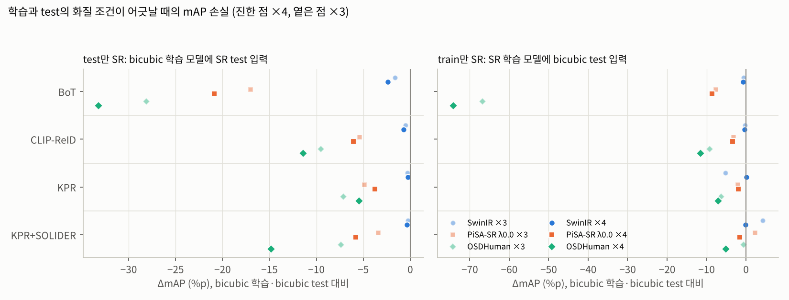

| SR | test만 SR (C 모델 + SR test) | train만 SR (S 모델 + bicubic test) |
|---|---|---|
| SwinIR | −2.4 ~ −0.2%p | −5.3 ~ +4.2%p ※ |
| PiSA-SR λ0.0 | −20.9 ~ −3.4%p | −8.6 ~ +2.3%p ※ |
| OSDHuman | −33.2 ~ −5.4%p | **−74.2** ~ −0.7%p |

범위는 4모델 × 2배율의 최소~최대. ※ 양수 값은 약하게 수렴한 KPR+SOLIDER ×3 bicubic 기준 모델 대비라서 생긴 값.

- **SR은 사실상 다른 도메인을 만듦.** 학습과 test 조건이 같을 때만 성능 유지
- **손실 크기는 Stage 1의 원본 이탈 순서(SwinIR < PiSA < OSDHuman)를 따름.** 4모델 × 2배율 × 2방향 16개 조합 중 15개에서 순서 일치(예외 1개는 약하게 수렴한 KPR ×3 SwinIR 모델)
- **BoT가 가장 취약**(OSDHuman ×4 train만 SR −74%p, test만 SR −33%p). test만 SR에서는 파트 기반 KPR이 가장 강건(OSDHuman ×4 −5.4%p)
- **실무 시사점:** 이미 배포된 ReID 모델 앞에 SR만 붙이는 방식은 위험. rs-sr-detect에서 공개 가중치 SR이 모두 LR 직접 탐지보다 낮았던 결과, SR을 단순히 앞에 붙이면 효과가 없거나 역효과라는 기존 보고와 같은 방향

---

## 7. 사후 분석

평가 완료 후 수행했으며 Stage 2 판정은 바꾸지 않음.

### 7.1 기준선 재확인

Stage 2 평가 코드로 공개 가중치 4종을 A100에서 다시 평가. BoT·KPR+SOLIDER는 소수 둘째 자리까지 일치, CLIP-ReID·KPR은 mAP ±0.01, R1 ±0.06%p 차이(GPU 종류에 따른 fp16 커널 차이). 4090에서 뽑은 특징에 같은 코드를 적용하면 4종 모두 일치. 판정 CI 폭(±0.2~0.5%p)보다 훨씬 작아 결과에 영향 없음.

### 7.2 train 표본과 test의 지표 분포

test SR 이미지에도 Stage 1과 같은 지표를 계산. 74개 조합 중 19개에서 CI가 겹치지 않지만 차이 크기는 매우 작음(예: OSDHuman DINOv3 코사인 +0.007, PiSA A-FINE −1.5). **Stage 1 표본은 test 분포를 잘 대표함.**

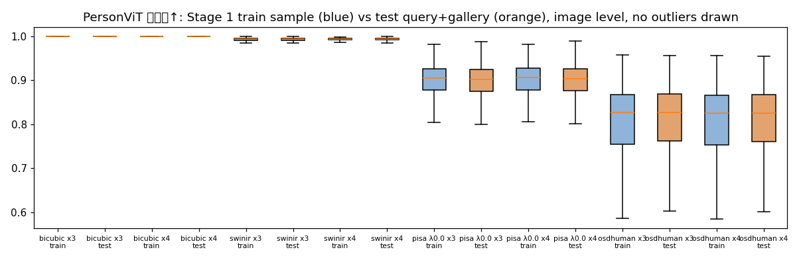

### 7.3 query 단위: 화질 지표가 ReID 이득을 예측하는가

ΔAP_q = (S 모델 + SR test의 query AP) − (C 모델 + bicubic test의 query AP)와 각 query SR 이미지의 지표 간 Spearman ρ.

| 결과 | 내용 |
|---|---|
| 상관 크기 | 지표 10종의 query ρ 중앙값 −0.03 ~ +0.02, query 이미지 지표 기준 최대 \|ρ\| ≈ 0.08 (정답 gallery 평균 기준 최대 ≈ 0.11) |
| 일관된 방향 | A-FINE 총점만 약한 음의 경향(낮을수록 좋음 → 품질 좋은 query가 약간 더 이득): 24조합 중 11개에서 CI < 0 |
| 결론 | 정답 없는 화질 지표로는 query별 ReID 효과를 거의 예측할 수 없음. rs-sr-detect의 PSNR–탐지 상관(ρ = 0.38, 방법 단위)보다도 약함 |

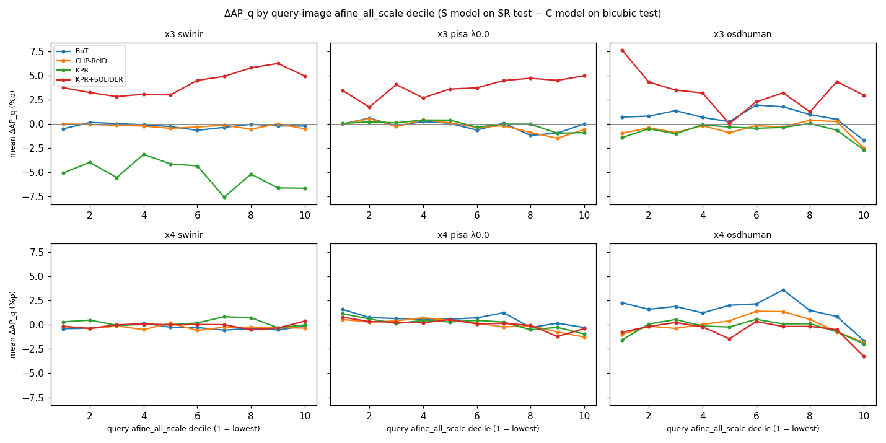

A-FINE 10분위별 평균 ΔAP_q: 분위에 따른 뚜렷한 경향 없이, 모델별 선의 높이(기준 모델 차이)가 대부분을 결정.

### 7.4 성공·실패 사례

OSDHuman ×4에서 4개 모델 평균 ΔAP_q 기준 가장 손해 본 query와 가장 이득 본 query. 각 줄: query(원본 | bicubic | SR), BoT C·S top-5, KPR+SOLIDER C·S top-5. 초록 = 정답, 빨강 = 오답.

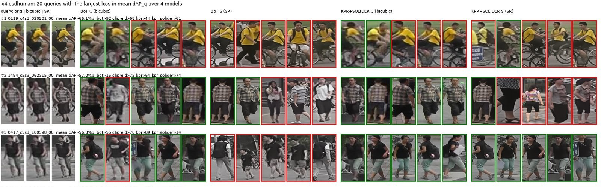

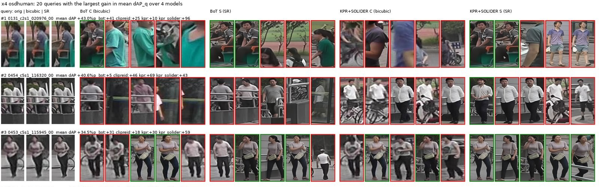

- 손해 사례 20개의 PersonViT 코사인 평균 0.62, 이득 사례 0.75로 **극단 사례에서는** 사람 특징이 많이 바뀐 query가 손해(평균 차이일 뿐 개별 예측력은 7.3절대로 약함)
- 위 손해 사례에서는 SR이 체크무늬·얼굴 등 세부를 다르게 그린 뒤 비슷한 옷의 다른 사람이 상위에 오는 모습이 보임(사례 일부를 눈으로 본 관찰)

---

## 8. 결론

1. **SR이 사람 ReID를 일관되게 개선하지 않음.** 학습·평가를 모두 SR로 맞춰도 효과는 모델에 따라 갈리고 대부분 ±0.7%p 이내
2. **개선은 약한 모델(BoT)과 강한 생성형 SR(OSDHuman) 조합에서만 일관되게 관찰.** 큰 입력에서의 bicubic 손실을 되돌리는 성격
3. **SR의 가장 확실한 효과는 도메인 이동.** 학습과 test의 조건이 어긋나면 큰 손실이 나며, 그 크기는 Stage 1의 원본 이탈 정도로 예측 가능
4. **정답 없는 화질 지표는 "얼마나 바뀌었나"는 잘 재지만 "ReID에 도움이 되나"는 예측하지 못함.** SR 선택은 결국 다운스트림 평가가 필요하다는 rs-sr-detect의 결론과 같음

---

## 9. 한계

2절의 해결 과정을 거치고도 남은 한계.

- **seed 1개.** CI는 test 표본 변동만 반영하고 학습 변동은 반영하지 못함. 약하게 수렴한 학습 2개(KPR+SOLIDER ×3 bicubic, KPR ×3 SwinIR)가 판정 4건을 좌우함
- **다중 비교 미보정.** 주 판정 24건, 귀무가설이 모두 참이어도 약 1.2건이 우연히 유의할 수 있음. 사후 상관 480개도 보정 없음
- **데이터셋 1개.** Market-1501에서만 검증, 다른 데이터셋·실제 저해상도 감시 영상으로 일반화 미검증
- **정답 고화질 이미지 없음.** "디테일을 맞게 복원했는가"는 원리적으로 측정 불가
- **SR 선정은 결과를 본 연구자 판단.** 사전 등록한 선정 규칙 없음
- **KPR·CLIP-ReID는 공식 기본 설정(cudnn.benchmark, fp16)으로 학습**해 같은 seed로도 비트 단위 재현 불가(BoT만 결정적)
- PersonViT 사전학습 체크포인트는 저자가 ReID 정확도로 선택해 벤치마크 정보가 간접적으로 포함됨
- 시간·처리량은 GPU 2장 병렬 실행 중 측정값

### 후속 실험 후보 (사후 탐색으로 구분해 보고할 것)

- 약하게 수렴한 2개 조건만 다른 seed로 재학습해 ※ 판정의 원인 확인
- ×2(256×128, 표준 입력)에서 bicubic 대신 SR: 실무에 가장 가까운 형태
- 사람 이미지로 SR 미세조정: rs-sr-detect에서 유일하게 효과가 있었던 방식

---

## 10. 재현

### 10.1 환경

conda env 8개(`/workspace/miniforge3/envs`), 구성 `env/*.yml`, 잠금 `env/*.lock.txt`.

| env | 용도 | torch |
|---|---|---|
| srreid-core | 데이터, BoT, 평가 | 2.1.2+cu118 |
| srreid-clipreid / srreid-kpr | CLIP-ReID / KPR·KPR+SOLIDER | 1.13.0+cu117 |
| srreid-realesrgan / srreid-mambair | Real-ESRGAN / SwinIR·HAT·MambaIRv2 | 2.1.2+cu118 |
| srreid-pisasr / srreid-osdhuman | PiSA-SR / OSDHuman | 2.0.1+cu117 |
| srreid-quality | DINOv3·PersonViT·A-FINE·FFT 지표 | 2.1.2+cu118 |

구버전 PyTorch(1.13·2.0)는 Hopper·Blackwell 세대를 지원하지 않으므로 Ampere·Ada GPU(A100, L40S, RTX 4090 등) 필요.

### 10.2 실행

```bash
source /workspace/setup_after_restart.sh       # 재시작 후 환경 복구
cd /workspace/sr-reid
bash stage1/run_a100_check.sh                  # Stage 1 재현성·동시 실행 확인
bash stage1/run_a100.sh                        # Stage 1 생성 → 지표 → 시각화
bash stage2/run_gen.sh                         # Stage 2 train·test 생성 (test는 잠금 해제 필요)
python stage2/train_queue.py                   # 학습 32회 대기열
python stage2/report.py                        # 평가 집계·판정·보고서
```

긴 작업은 `bash scripts/run_bg.sh <이름> <명령>`으로 별도 tmux 세션에서 실행. 완료 표시가 있는 단계는 재실행 시 건너뜀.

### 10.3 디렉터리

```
stage0/  stage05/  stage1/  stage2/   단계별 코드
reid/  eval/  sr/  common/            BoT 구현, 평가, SR 실행기, test 가드
configs/stage1_sample.csv             Stage 1 표본 (751명 2,250장)
results/stage1/                       Stage 1 지표 원시값·요약·t-SNE 좌표
results/stage2/                       평가 80칸(eval_cells.csv), 판정 144행(judgment.csv)
results/stage2_analysis/              사후 분석 표·그림
docs/                                 설계(DESIGN.md), 모델별 파이프라인 문서
docs/readme/                          이 README의 그림
```

---

## 11. 데이터·모델 표기

- **Market-1501:** 데이터셋 조건에 따라 연구 목적 외 사용·재배포 금지. 이미지는 저장소에 포함하지 않으며, README의 사례 그림은 연구 결과 설명을 위한 일부 발췌임. test 이미지는 최종 평가와 사후 분석에서만 사용하고 접근 기록은 `logs/test_access.log`에 남김
- **DINOv3:** 이 연구는 Meta의 DINOv3(DINO Materials, timm 변환 가중치 `vit_large_patch16_dinov3.lvd1689m`)를 사용함(DINOv3 License 1.b.ii 표기 의무)
- **PersonViT:** `lakeAGI/PersonViT` LUPerson 자기지도 사전학습 가중치(코드 Apache-2.0, 가중치 "cc" 표기)
- **A-FINE:** pyiqa 사본 가중치(CC-BY-NC-SA-4.0)
- **OSDHuman:** 저장소에 LICENSE 없음, 연구 범위에서만 사용
- SR·ReID 가중치 SHA256: `weights/SHA256.csv`, `weights/stage1/SHA256.csv`
