# Stage 2 사후 분석: 기준선 재확인, test SR 품질 지표, query 단위 분석, 성공·실패 사례

**평가 완료 후 사후 분석이며 Stage 2 판정(`STAGE2_REPORT.md`, `results/stage2/judgment.csv`)과 별개다. 판정은 바꾸지 않았다.** 서버 A100 SXM4 80GB ×2(EPYC 7713, cgroup v2), 2026-11-12. test 접근은 사용자 잠금 해제 창에서만 했고 `logs/test_access.log`에 기록했다. query별 원시 값과 특징은 잠긴 영역 `data/locked/stage2_analysis/`, 집계·그림은 `results/stage2_analysis/`.

## 1. 기준선 재확인

공개 가중치, 공식 입력 크기, 원본 test(query 3,368, gallery 15,913). 특징은 Stage 0.5 기준선 추출기로 새로 뽑고(공개 BoT는 공식 reid-strong-baseline 구조라 Stage 2 자체 BoT 추출기로 읽을 수 없음), 지표는 Stage 2 평가 코드(`stage2/evaluate.py` make_dist + `eval_core.stream_eval`).

| 모델 | 입력 | 이번 mAP / R1 (A100 재추출) | Stage 0.5 (4090) | 소수 둘째 자리 일치 |
|---|---|---|---|---|
| BoT | 256x128 | 85.95 / 94.63 | 85.95 / 94.63 | 통과 |
| CLIP-ReID | 256x128 | 89.65 / 95.37 | 89.66 / 95.43 | 불일치 |
| KPR | 384x128 | 89.58 / 95.87 | 89.59 / 95.87 | 불일치 |
| KPR+SOLIDER | 384x128 | 93.25 / 96.59 | 93.25 / 96.59 | 통과 |

- **원인**: 같은 Stage 2 지표 코드를 Stage 0.5(RTX 4090)에서 뽑아 둔 특징에 적용하면 네 모델 모두 기준값과 일치한다(BoT 85.95/94.63, CLIP-ReID 89.66/95.43, KPR 89.586/95.873 → 89.59/95.87, KPR+SOLIDER 93.249/96.586 → 93.25/96.59). 차이는 A100에서 특징을 다시 뽑을 때 생긴다(fp16·커널이 GPU 종류에 따라 다름): CLIP-ReID 특징 최대 |차이| 0.075(평균 2e-4), KPR 0.007.
- CLIP-ReID: A100 89.6529/95.3682 — Rank-1은 query 2개 차이(−0.06%p). KPR: A100 89.5806/95.8729 — mAP −0.006%p가 반올림 경계를 넘은 것. BoT(85.9468/94.6259), KPR+SOLIDER(93.2487/96.5855)는 A100에서도 둘째 자리까지 일치.
- **KPR+SOLIDER 로드 수정 확인**: Stage 2 추출기(`stage2/train_kpr.py --extract`, semantic_embed 키 허용 수정 포함)와 Stage 0.5 추출기(`stage05/kpr_run.py`)를 같은 공개 가중치·같은 입력(×3 bicubic query 3,368장)에 돌린 특징과 가시성이 비트 단위로 같다(최대 |차이| 0.0).
- **Stage 2 결과 영향 없음**: Stage 2의 80개 셀은 모두 같은 A100·같은 코드로 추출해 셀 간 비교(판정)에는 이 효과가 없다. 4090에서 했다면 절댓값이 이 정도(mAP ±0.01, Rank-1 ±0.06%p) 달랐을 수 있고, 판정 CI 폭(대략 ±0.2~0.5%p)보다 훨씬 작다.

## 2b. Stage 1 train 표본 대 test 지표 분포

test 지표는 Stage 1과 같은 모델·전처리·설정(원본 test 이미지 대비)으로 {bicubic, swinir, pisa λ0.0, osdhuman} × {×3, ×4} × (query 3,368 + gallery 19,732)에 계산했다. 분포 비교는 사람 이미지(pid > 0, junk·방해 이미지 제외) 기준, 집계는 Stage 1과 같다(이미지 → 신원 평균 → 신원 평균의 평균, 신원 단위 부트스트랩 95% CI 10,000회, seed 42). bicubic의 A-FINE은 기준 이미지와 같아 비교 불가.

DINOv3 코사인 (높을수록 원본과 가까움)

| 방법 | 배율 | train 표본 평균 [CI] | test 평균 [CI] | test − train | CI 겹침 |
|---|---|---|---|---|---|
| bicubic | 3 | 0.9991 [0.9991, 0.9991] | 0.9991 [0.9991, 0.9991] | +5.685e-06 | 예 |
| bicubic | 4 | 0.9984 [0.9983, 0.9984] | 0.9984 [0.9984, 0.9985] | +8.922e-05 | 아니오 |
| swinir | 3 | 0.9513 [0.9497, 0.9528] | 0.9512 [0.9501, 0.9522] | -0.0001184 | 예 |
| swinir | 4 | 0.9487 [0.9472, 0.9503] | 0.9486 [0.9476, 0.9497] | -8.072e-05 | 예 |
| pisa λ0.0 | 3 | 0.7986 [0.7958, 0.8014] | 0.7985 [0.797, 0.8] | -0.0001266 | 예 |
| pisa λ0.0 | 4 | 0.7919 [0.789, 0.7948] | 0.7918 [0.7903, 0.7934] | -0.0001031 | 예 |
| osdhuman | 3 | 0.6567 [0.6529, 0.6604] | 0.6634 [0.6611, 0.6656] | +0.00671 | 아니오 |
| osdhuman | 4 | 0.6459 [0.6422, 0.6496] | 0.6523 [0.65, 0.6545] | +0.006361 | 아니오 |

PersonViT 코사인 (높을수록 원본과 가까움)

| 방법 | 배율 | train 표본 평균 [CI] | test 평균 [CI] | test − train | CI 겹침 |
|---|---|---|---|---|---|
| bicubic | 3 | 0.9999 [0.9999, 0.9999] | 0.9999 [0.9999, 0.9999] | +2.823e-06 | 예 |
| bicubic | 4 | 0.9996 [0.9996, 0.9996] | 0.9996 [0.9996, 0.9996] | +6.371e-06 | 예 |
| swinir | 3 | 0.993 [0.9928, 0.9932] | 0.9929 [0.9928, 0.993] | -0.0001288 | 예 |
| swinir | 4 | 0.9932 [0.993, 0.9934] | 0.9931 [0.993, 0.9932] | -0.0001109 | 예 |
| pisa λ0.0 | 3 | 0.8986 [0.8966, 0.9006] | 0.8964 [0.8947, 0.898] | -0.002273 | 예 |
| pisa λ0.0 | 4 | 0.8995 [0.8975, 0.9015] | 0.8973 [0.8957, 0.8989] | -0.002265 | 예 |
| osdhuman | 3 | 0.8037 [0.7998, 0.8076] | 0.807 [0.8042, 0.8099] | +0.003341 | 예 |
| osdhuman | 4 | 0.8027 [0.7988, 0.8065] | 0.806 [0.8031, 0.8088] | +0.003293 | 예 |

A-FINE 총점 (낮을수록 좋음)

| 방법 | 배율 | train 표본 평균 [CI] | test 평균 [CI] | test − train | CI 겹침 |
|---|---|---|---|---|---|
| swinir | 3 | 45.02 [44.67, 45.36] | 44.55 [44.3, 44.79] | -0.4718 | 예 |
| swinir | 4 | 45.2 [44.86, 45.53] | 44.74 [44.46, 44.99] | -0.4632 | 예 |
| pisa λ0.0 | 3 | 12.03 [11.31, 12.74] | 10.54 [10.09, 10.99] | -1.489 | 아니오 |
| pisa λ0.0 | 4 | 10.5 [9.787, 11.22] | 8.814 [8.386, 9.242] | -1.685 | 아니오 |
| osdhuman | 3 | 0.4683 [0.3032, 0.6559] | 0.3495 [0.2676, 0.4406] | -0.1188 | 예 |
| osdhuman | 4 | 0.04082 [0.01651, 0.0692] | 0.03962 [0.02243, 0.06124] | -0.001202 | 예 |

A-FINE 충실도 (낮을수록 좋음)

| 방법 | 배율 | train 표본 평균 [CI] | test 평균 [CI] | test − train | CI 겹침 |
|---|---|---|---|---|---|
| swinir | 3 | -1.874 [-1.881, -1.867] | -1.867 [-1.872, -1.862] | +0.007192 | 예 |
| swinir | 4 | -1.868 [-1.876, -1.86] | -1.857 [-1.864, -1.851] | +0.01089 | 예 |
| pisa λ0.0 | 3 | -0.1438 [-0.1934, -0.09322] | -0.03366 [-0.0692, 0.002188] | +0.1102 | 아니오 |
| pisa λ0.0 | 4 | -0.3024 [-0.3527, -0.2509] | -0.1891 [-0.2259, -0.152] | +0.1133 | 아니오 |
| osdhuman | 3 | 1.535 [1.51, 1.557] | 1.574 [1.558, 1.589] | +0.03975 | 아니오 |
| osdhuman | 4 | 1.62 [1.599, 1.639] | 1.656 [1.642, 1.668] | +0.03598 | 아니오 |

A-FINE 자연스러움 (낮을수록 좋음)

| 방법 | 배율 | train 표본 평균 [CI] | test 평균 [CI] | test − train | CI 겹침 |
|---|---|---|---|---|---|
| swinir | 3 | -0.2224 [-0.2309, -0.2141] | -0.2381 [-0.2443, -0.232] | -0.01571 | 아니오 |
| swinir | 4 | -0.1717 [-0.1785, -0.165] | -0.1837 [-0.1888, -0.1787] | -0.01201 | 아니오 |
| pisa λ0.0 | 3 | -0.5251 [-0.5376, -0.5128] | -0.5542 [-0.5637, -0.5448] | -0.02907 | 아니오 |
| pisa λ0.0 | 4 | -0.4688 [-0.4795, -0.4584] | -0.4944 [-0.5022, -0.4867] | -0.02559 | 아니오 |
| osdhuman | 3 | -0.9486 [-0.9647, -0.932] | -0.9995 [-1.014, -0.9849] | -0.0509 | 아니오 |
| osdhuman | 4 | -0.894 [-0.9066, -0.8812] | -0.9379 [-0.9497, -0.9262] | -0.04387 | 아니오 |

저주파 일치도 (높을수록 일치)

| 방법 | 배율 | train 표본 평균 [CI] | test 평균 [CI] | test − train | CI 겹침 |
|---|---|---|---|---|---|
| bicubic | 3 | 0.9994 [0.9994, 0.9995] | 0.9994 [0.9994, 0.9994] | -2.118e-05 | 예 |
| bicubic | 4 | 0.9994 [0.9994, 0.9994] | 0.9994 [0.9994, 0.9994] | -2.153e-05 | 예 |
| swinir | 3 | 0.9989 [0.9988, 0.9989] | 0.9989 [0.9988, 0.9989] | -1.209e-05 | 예 |
| swinir | 4 | 0.9988 [0.9987, 0.9989] | 0.9988 [0.9987, 0.9988] | -2.407e-05 | 예 |
| pisa λ0.0 | 3 | 0.9823 [0.9818, 0.9828] | 0.9824 [0.982, 0.9827] | +5.563e-05 | 예 |
| pisa λ0.0 | 4 | 0.982 [0.9816, 0.9825] | 0.9821 [0.9817, 0.9824] | +4.827e-05 | 예 |
| osdhuman | 3 | 0.9751 [0.9745, 0.9757] | 0.9758 [0.9754, 0.9763] | +0.0007286 | 예 |
| osdhuman | 4 | 0.9747 [0.9741, 0.9753] | 0.9754 [0.975, 0.9759] | +0.0007444 | 예 |

고주파 추가량 dB (방향 없음)

| 방법 | 배율 | train 표본 평균 [CI] | test 평균 [CI] | test − train | CI 겹침 |
|---|---|---|---|---|---|
| bicubic | 3 | 0 [0, 0] | 0 [0, 0] | +0 | 예 |
| bicubic | 4 | 0 [0, 0] | 0 [0, 0] | +0 | 예 |
| swinir | 3 | 6.813 [6.734, 6.891] | 6.81 [6.759, 6.862] | -0.00311 | 예 |
| swinir | 4 | 6.649 [6.569, 6.731] | 6.662 [6.607, 6.717] | +0.01214 | 예 |
| pisa λ0.0 | 3 | 10.27 [10.19, 10.36] | 10.21 [10.15, 10.27] | -0.06316 | 예 |
| pisa λ0.0 | 4 | 10.45 [10.36, 10.53] | 10.4 [10.34, 10.47] | -0.04879 | 예 |
| osdhuman | 3 | 15.39 [15.28, 15.5] | 15.3 [15.22, 15.38] | -0.09467 | 예 |
| osdhuman | 4 | 16.57 [16.47, 16.68] | 16.49 [16.41, 16.57] | -0.08508 | 예 |

스펙트럼 기울기 편차 (0이 원본)

| 방법 | 배율 | train 표본 평균 [CI] | test 평균 [CI] | test − train | CI 겹침 |
|---|---|---|---|---|---|
| bicubic | 3 | -4.298 [-4.384, -4.212] | -4.456 [-4.517, -4.395] | -0.1574 | 아니오 |
| bicubic | 4 | -1.765 [-1.83, -1.701] | -1.881 [-1.927, -1.835] | -0.1153 | 아니오 |
| swinir | 3 | -3.925 [-3.977, -3.873] | -4.028 [-4.063, -3.993] | -0.1026 | 아니오 |
| swinir | 4 | -3.424 [-3.477, -3.37] | -3.527 [-3.564, -3.491] | -0.1036 | 아니오 |
| pisa λ0.0 | 3 | -3.682 [-3.716, -3.649] | -3.707 [-3.733, -3.682] | -0.02446 | 예 |
| pisa λ0.0 | 4 | -3.594 [-3.631, -3.557] | -3.631 [-3.659, -3.604] | -0.03728 | 예 |
| osdhuman | 3 | -0.2313 [-0.2671, -0.1964] | -0.273 [-0.2976, -0.2483] | -0.04173 | 예 |
| osdhuman | 4 | 0.3696 [0.3352, 0.403] | 0.3306 [0.3066, 0.3548] | -0.03895 | 예 |

격자 피크 dB (낮을수록 약함)

| 방법 | 배율 | train 표본 평균 [CI] | test 평균 [CI] | test − train | CI 겹침 |
|---|---|---|---|---|---|
| bicubic | 3 | 4.576 [4.452, 4.704] | 4.521 [4.463, 4.578] | -0.0552 | 예 |
| bicubic | 4 | 6.936 [6.827, 7.045] | 6.885 [6.829, 6.941] | -0.05004 | 예 |
| swinir | 3 | 8.554 [8.431, 8.676] | 8.518 [8.45, 8.588] | -0.03678 | 예 |
| swinir | 4 | 12.71 [12.61, 12.82] | 12.73 [12.67, 12.79] | +0.01699 | 예 |
| pisa λ0.0 | 3 | 10.78 [10.62, 10.94] | 10.57 [10.46, 10.67] | -0.2154 | 예 |
| pisa λ0.0 | 4 | 12.93 [12.75, 13.12] | 12.64 [12.52, 12.77] | -0.2871 | 예 |
| osdhuman | 3 | 11.26 [11.11, 11.41] | 11.4 [11.3, 11.5] | +0.1429 | 예 |
| osdhuman | 4 | 11.65 [11.52, 11.78] | 11.77 [11.68, 11.86] | +0.1201 | 예 |

ΔE2000 (낮을수록 색 차이 작음)

| 방법 | 배율 | train 표본 평균 [CI] | test 평균 [CI] | test − train | CI 겹침 |
|---|---|---|---|---|---|
| bicubic | 3 | 0.5029 [0.495, 0.5111] | 0.516 [0.51, 0.5223] | +0.0131 | 예 |
| bicubic | 4 | 0.5113 [0.5035, 0.5195] | 0.5244 [0.5184, 0.5306] | +0.01302 | 예 |
| swinir | 3 | 0.07858 [0.07741, 0.0798] | 0.08072 [0.07976, 0.08171] | +0.002146 | 예 |
| swinir | 4 | 0.0729 [0.07164, 0.07424] | 0.07475 [0.07372, 0.07583] | +0.001849 | 예 |
| pisa λ0.0 | 3 | 2.273 [2.254, 2.292] | 2.308 [2.292, 2.324] | +0.03486 | 예 |
| pisa λ0.0 | 4 | 2.267 [2.248, 2.287] | 2.303 [2.287, 2.319] | +0.03532 | 예 |
| osdhuman | 3 | 3.486 [3.457, 3.515] | 3.526 [3.498, 3.555] | +0.04053 | 예 |
| osdhuman | 4 | 3.485 [3.456, 3.514] | 3.525 [3.498, 3.554] | +0.04062 | 예 |

train 표본과 test의 CI가 겹치지 않는 조합: 19/74. 차이의 크기는 'test − train' 열, 방향은 지표 설명을 따른다.

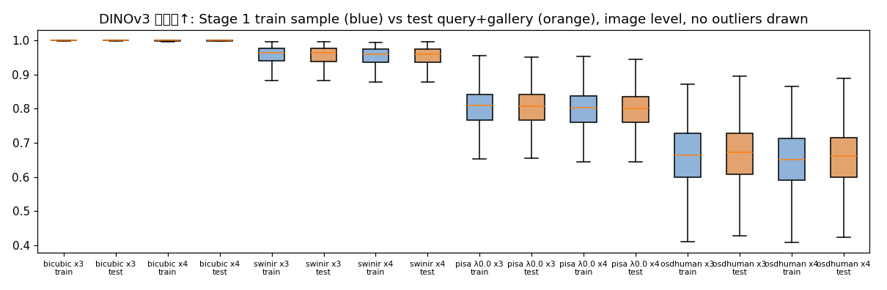

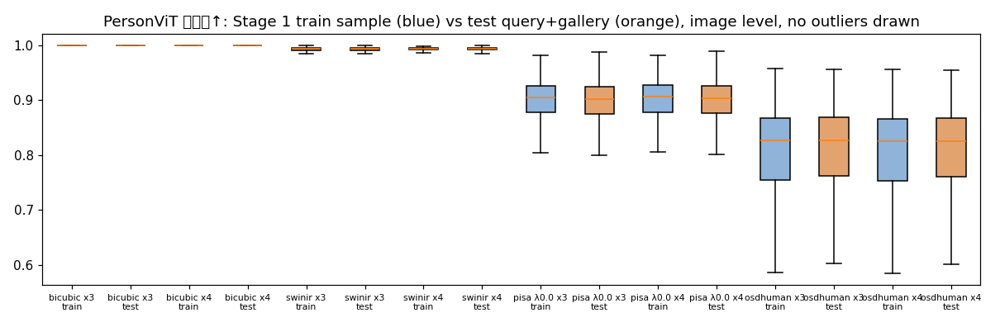

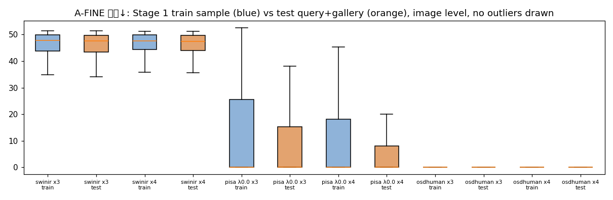

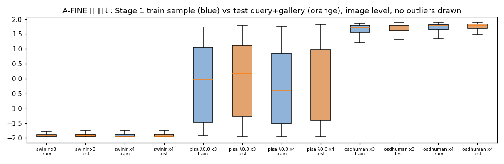

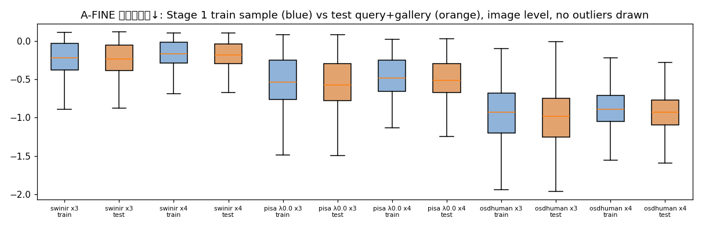

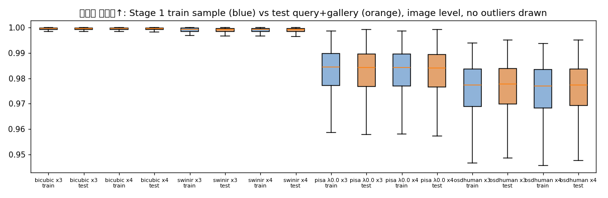

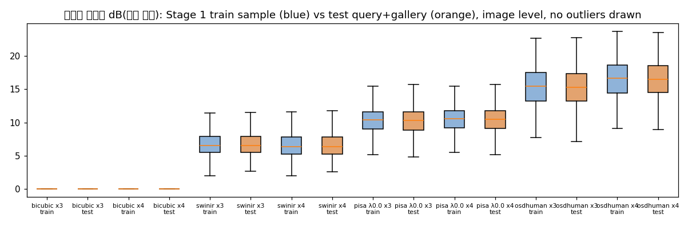

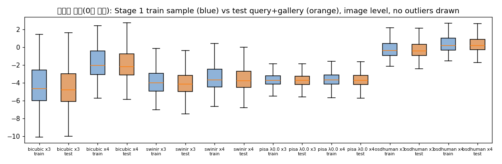

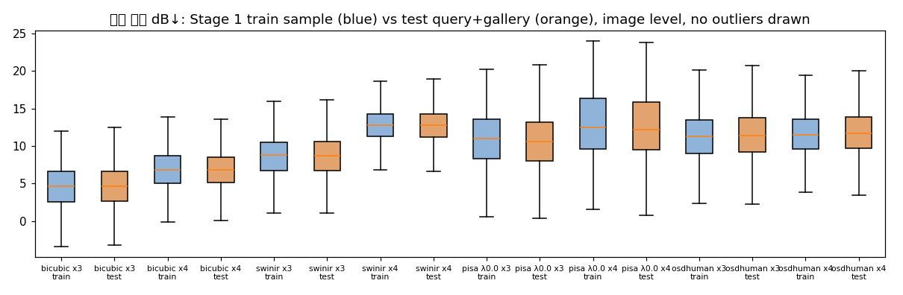

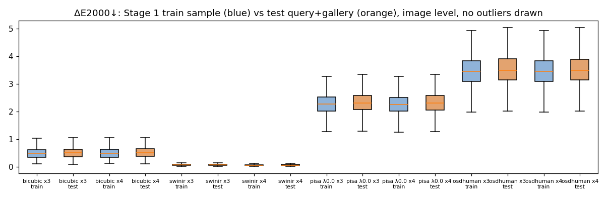

## 2c. query 단위 분석: ΔAP_q와 지표의 Spearman 상관

ΔAP_q = (SR로 학습한 모델 + SR test의 query AP) − (bicubic 모델 + bicubic test의 query AP). 설명 변수는 그 query SR 이미지의 지표 값, 그리고 같은 신원·다른 카메라 정답 gallery SR 이미지들의 지표 평균. ρ는 query 단위와 신원 단위 평균(같은 사람의 query끼리 상관된 문제를 줄임) 두 가지, 95% CI는 신원 단위 부트스트랩(10,000회, seed 42, 복원추출 횟수를 가중치로 한 가중 Spearman).

지표별 요약(모델 4 × 배율 2 × SR 3 = 최대 24조합에 걸친 ρ 분포). 'CI>0 / CI<0'은 95% CI가 0을 벗어난 조합 수(보정하지 않음).

| 지표 | 설명 변수 | 조합 수 | query ρ 중앙값 [최소, 최대] | query ρ CI>0 / CI<0 | 신원 ρ 중앙값 [최소, 최대] | 신원 ρ CI>0 / CI<0 |
|---|---|---|---|---|---|---|
| DINOv3 코사인 (높을수록 원본과 가까움) | query 이미지 | 24 | +0.015 [-0.042, +0.047] | 7 / 1 | +0.027 [-0.069, +0.106] | 3 / 0 |
| DINOv3 코사인 (높을수록 원본과 가까움) | 정답 gallery 평균 | 24 | +0.014 [-0.041, +0.092] | 4 / 0 | +0.015 [-0.054, +0.147] | 5 / 0 |
| PersonViT 코사인 (높을수록 원본과 가까움) | query 이미지 | 24 | +0.009 [-0.056, +0.080] | 5 / 1 | +0.019 [-0.117, +0.192] | 7 / 1 |
| PersonViT 코사인 (높을수록 원본과 가까움) | 정답 gallery 평균 | 24 | +0.002 [-0.063, +0.092] | 6 / 1 | +0.017 [-0.103, +0.176] | 5 / 1 |
| A-FINE 총점 (낮을수록 좋음) | query 이미지 | 24 | -0.028 [-0.077, +0.048] | 2 / 11 | -0.055 [-0.136, +0.081] | 2 / 6 |
| A-FINE 총점 (낮을수록 좋음) | 정답 gallery 평균 | 24 | -0.009 [-0.083, +0.091] | 4 / 7 | -0.037 [-0.133, +0.128] | 3 / 7 |
| A-FINE 충실도 (낮을수록 좋음) | query 이미지 | 24 | +0.023 [-0.041, +0.059] | 6 / 1 | +0.041 [-0.096, +0.114] | 7 / 1 |
| A-FINE 충실도 (낮을수록 좋음) | 정답 gallery 평균 | 24 | +0.006 [-0.076, +0.092] | 7 / 3 | +0.032 [-0.099, +0.144] | 7 / 3 |
| A-FINE 자연스러움 (낮을수록 좋음) | query 이미지 | 24 | -0.018 [-0.067, +0.048] | 1 / 8 | -0.011 [-0.109, +0.090] | 3 / 3 |
| A-FINE 자연스러움 (낮을수록 좋음) | 정답 gallery 평균 | 24 | +0.001 [-0.068, +0.079] | 5 / 6 | -0.007 [-0.113, +0.103] | 3 / 7 |
| 저주파 일치도 (높을수록 일치) | query 이미지 | 24 | +0.018 [-0.066, +0.057] | 7 / 1 | +0.037 [-0.118, +0.116] | 6 / 1 |
| 저주파 일치도 (높을수록 일치) | 정답 gallery 평균 | 24 | +0.024 [-0.081, +0.084] | 6 / 1 | +0.051 [-0.141, +0.136] | 6 / 1 |
| 고주파 추가량 dB (방향 없음) | query 이미지 | 24 | -0.008 [-0.059, +0.020] | 0 / 4 | -0.016 [-0.110, +0.029] | 0 / 4 |
| 고주파 추가량 dB (방향 없음) | 정답 gallery 평균 | 24 | -0.016 [-0.076, +0.040] | 0 / 4 | -0.023 [-0.120, +0.032] | 0 / 4 |
| 스펙트럼 기울기 편차 (0이 원본) | query 이미지 | 24 | -0.012 [-0.069, +0.065] | 1 / 5 | -0.024 [-0.158, +0.115] | 2 / 5 |
| 스펙트럼 기울기 편차 (0이 원본) | 정답 gallery 평균 | 24 | -0.004 [-0.078, +0.082] | 3 / 6 | -0.008 [-0.143, +0.106] | 1 / 6 |
| 격자 피크 dB (낮을수록 약함) | query 이미지 | 24 | -0.000 [-0.073, +0.038] | 1 / 5 | -0.025 [-0.095, +0.052] | 0 / 2 |
| 격자 피크 dB (낮을수록 약함) | 정답 gallery 평균 | 24 | -0.001 [-0.075, +0.060] | 1 / 4 | -0.011 [-0.152, +0.070] | 0 / 4 |
| ΔE2000 (낮을수록 색 차이 작음) | query 이미지 | 24 | -0.007 [-0.079, +0.050] | 2 / 5 | -0.003 [-0.156, +0.083] | 2 / 3 |
| ΔE2000 (낮을수록 색 차이 작음) | 정답 gallery 평균 | 24 | -0.011 [-0.111, +0.049] | 1 / 5 | -0.024 [-0.163, +0.091] | 2 / 3 |

BoT: query 이미지 지표와 ΔAP_q의 Spearman ρ(query 단위). CI는 `results/stage2_analysis/spearman_dAP_metrics.csv`.

| 지표 | x3 osdhuman | x3 pisa λ0.0 | x3 swinir | x4 osdhuman | x4 pisa λ0.0 | x4 swinir |
|---|---|---|---|---|---|---|
| DINOv3 코사인 (높을수록 원본과 가까움) | +0.015 | +0.006 | +0.020 | +0.036 | +0.001 | +0.000 |
| PersonViT 코사인 (높을수록 원본과 가까움) | +0.021 | +0.011 | +0.001 | +0.022 | -0.021 | +0.004 |
| A-FINE 총점 (낮을수록 좋음) | -0.043 | -0.028 | +0.010 | -0.077 | -0.018 | -0.013 |
| A-FINE 충실도 (낮을수록 좋음) | +0.029 | +0.030 | -0.008 | +0.015 | +0.019 | +0.012 |
| A-FINE 자연스러움 (낮을수록 좋음) | -0.002 | -0.027 | +0.014 | -0.004 | -0.015 | -0.011 |
| 저주파 일치도 (높을수록 일치) | +0.057 | +0.026 | +0.003 | +0.043 | +0.010 | -0.026 |
| 고주파 추가량 dB (방향 없음) | -0.008 | -0.010 | -0.008 | -0.010 | +0.005 | -0.008 |
| 스펙트럼 기울기 편차 (0이 원본) | -0.012 | -0.012 | -0.009 | -0.021 | -0.005 | -0.027 |
| 격자 피크 dB (낮을수록 약함) | +0.011 | -0.053 | -0.029 | -0.023 | -0.032 | +0.016 |
| ΔE2000 (낮을수록 색 차이 작음) | -0.079 | -0.018 | +0.004 | -0.066 | -0.044 | -0.003 |

CLIP-ReID: query 이미지 지표와 ΔAP_q의 Spearman ρ(query 단위). CI는 `results/stage2_analysis/spearman_dAP_metrics.csv`.

| 지표 | x3 osdhuman | x3 pisa λ0.0 | x3 swinir | x4 osdhuman | x4 pisa λ0.0 | x4 swinir |
|---|---|---|---|---|---|---|
| DINOv3 코사인 (높을수록 원본과 가까움) | +0.041 | +0.012 | -0.022 | +0.018 | +0.015 | -0.008 |
| PersonViT 코사인 (높을수록 원본과 가까움) | +0.019 | +0.006 | +0.000 | +0.027 | +0.007 | +0.012 |
| A-FINE 총점 (낮을수록 좋음) | -0.052 | -0.027 | -0.013 | -0.054 | -0.050 | +0.005 |
| A-FINE 충실도 (낮을수록 좋음) | +0.050 | +0.030 | +0.018 | +0.024 | +0.051 | +0.014 |
| A-FINE 자연스러움 (낮을수록 좋음) | -0.048 | -0.021 | -0.012 | -0.026 | -0.049 | +0.002 |
| 저주파 일치도 (높을수록 일치) | +0.019 | +0.042 | -0.012 | +0.029 | +0.048 | -0.006 |
| 고주파 추가량 dB (방향 없음) | -0.017 | +0.005 | +0.018 | -0.012 | +0.003 | +0.015 |
| 스펙트럼 기울기 편차 (0이 원본) | -0.016 | +0.026 | -0.004 | -0.017 | +0.004 | -0.013 |
| 격자 피크 dB (낮을수록 약함) | +0.004 | -0.021 | +0.005 | +0.030 | -0.054 | -0.005 |
| ΔE2000 (낮을수록 색 차이 작음) | +0.018 | -0.009 | +0.009 | +0.011 | +0.004 | +0.019 |

KPR: query 이미지 지표와 ΔAP_q의 Spearman ρ(query 단위). CI는 `results/stage2_analysis/spearman_dAP_metrics.csv`.

| 지표 | x3 osdhuman | x3 pisa λ0.0 | x3 swinir | x4 osdhuman | x4 pisa λ0.0 | x4 swinir |
|---|---|---|---|---|---|---|
| DINOv3 코사인 (높을수록 원본과 가까움) | +0.037 | +0.015 | -0.042 | +0.047 | +0.011 | -0.010 |
| PersonViT 코사인 (높을수록 원본과 가까움) | +0.052 | +0.001 | +0.045 | +0.054 | +0.029 | -0.022 |
| A-FINE 총점 (낮을수록 좋음) | -0.025 | -0.040 | -0.053 | -0.045 | -0.039 | -0.010 |
| A-FINE 충실도 (낮을수록 좋음) | +0.021 | +0.044 | +0.056 | +0.028 | +0.041 | +0.012 |
| A-FINE 자연스러움 (낮을수록 좋음) | -0.035 | -0.048 | -0.053 | -0.042 | -0.041 | -0.014 |
| 저주파 일치도 (높을수록 일치) | +0.040 | -0.010 | -0.066 | +0.037 | +0.001 | +0.003 |
| 고주파 추가량 dB (방향 없음) | -0.044 | -0.020 | +0.020 | -0.059 | -0.034 | +0.002 |
| 스펙트럼 기울기 편차 (0이 원본) | -0.042 | -0.004 | -0.069 | -0.065 | -0.025 | -0.009 |
| 격자 피크 dB (낮을수록 약함) | +0.026 | -0.062 | +0.023 | +0.012 | -0.040 | -0.009 |
| ΔE2000 (낮을수록 색 차이 작음) | -0.027 | +0.024 | +0.050 | -0.039 | -0.015 | +0.017 |

KPR+SOLIDER: query 이미지 지표와 ΔAP_q의 Spearman ρ(query 단위). CI는 `results/stage2_analysis/spearman_dAP_metrics.csv`.

| 지표 | x3 osdhuman | x3 pisa λ0.0 | x3 swinir | x4 osdhuman | x4 pisa λ0.0 | x4 swinir |
|---|---|---|---|---|---|---|
| DINOv3 코사인 (높을수록 원본과 가까움) | +0.007 | +0.041 | +0.035 | +0.046 | +0.046 | +0.009 |
| PersonViT 코사인 (높을수록 원본과 가까움) | +0.005 | -0.013 | -0.056 | +0.080 | +0.065 | -0.007 |
| A-FINE 총점 (낮을수록 좋음) | -0.017 | +0.036 | +0.048 | -0.061 | -0.055 | -0.004 |
| A-FINE 충실도 (낮을수록 좋음) | -0.024 | -0.032 | -0.041 | +0.029 | +0.059 | -0.003 |
| A-FINE 자연스러움 (낮을수록 좋음) | +0.018 | +0.028 | +0.048 | -0.038 | -0.067 | -0.003 |
| 저주파 일치도 (높을수록 일치) | +0.018 | +0.042 | +0.057 | +0.033 | -0.005 | -0.007 |
| 고주파 추가량 dB (방향 없음) | +0.003 | +0.005 | +0.003 | -0.055 | -0.006 | -0.015 |
| 스펙트럼 기울기 편차 (0이 원본) | +0.016 | +0.032 | +0.065 | -0.068 | -0.041 | +0.001 |
| 격자 피크 dB (낮을수록 약함) | +0.015 | -0.018 | +0.017 | +0.023 | -0.073 | +0.038 |
| ΔE2000 (낮을수록 색 차이 작음) | -0.005 | -0.011 | -0.041 | -0.012 | +0.043 | -0.011 |

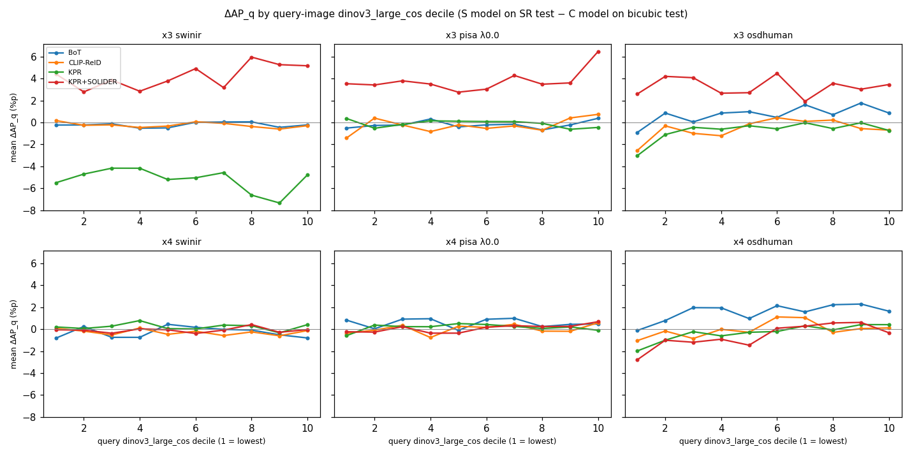

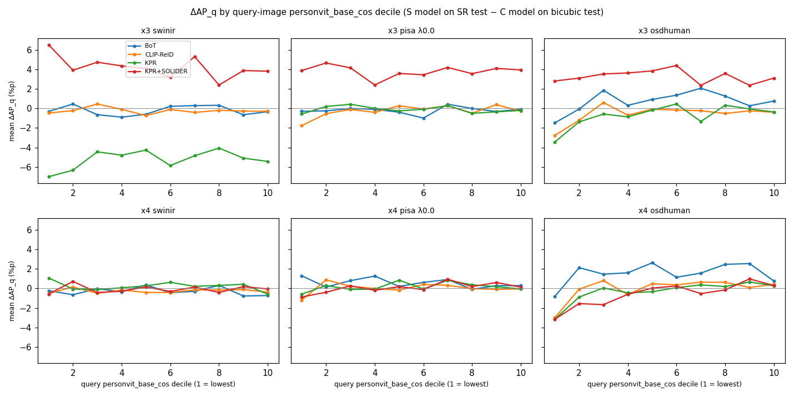

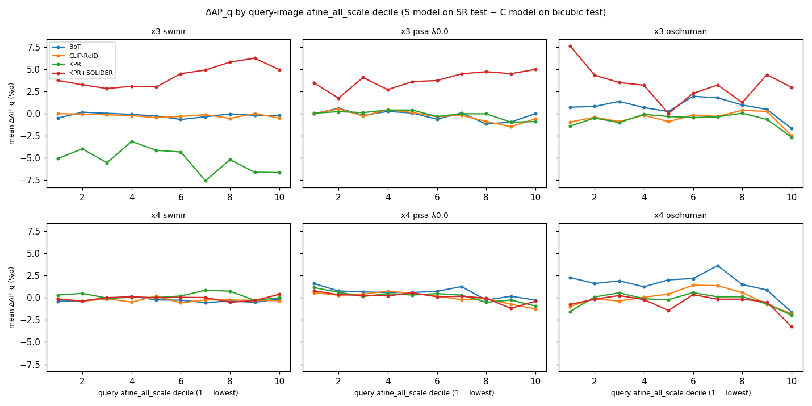

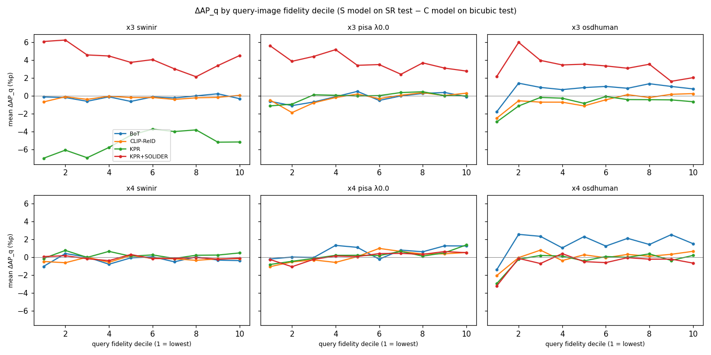

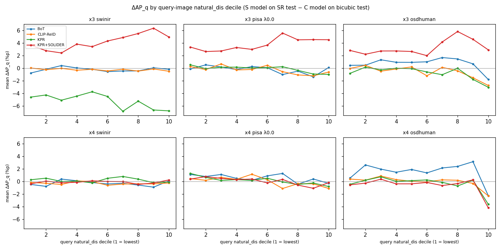

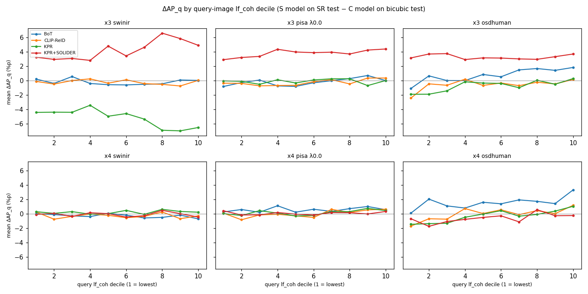

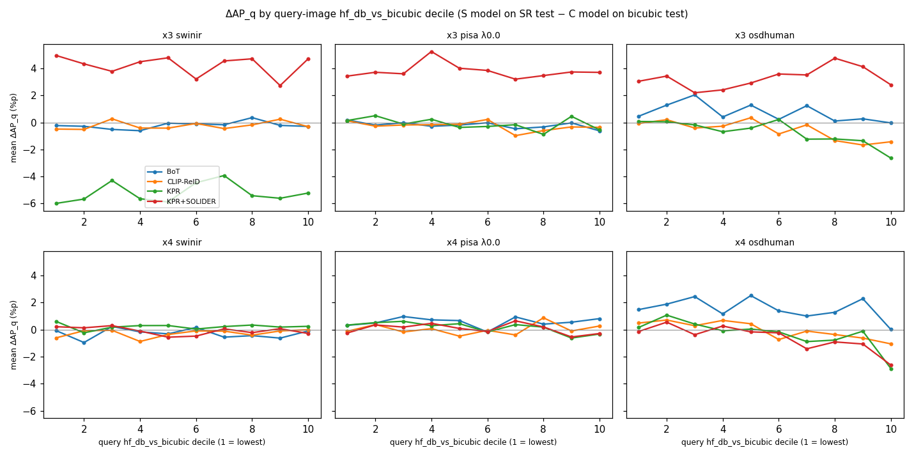

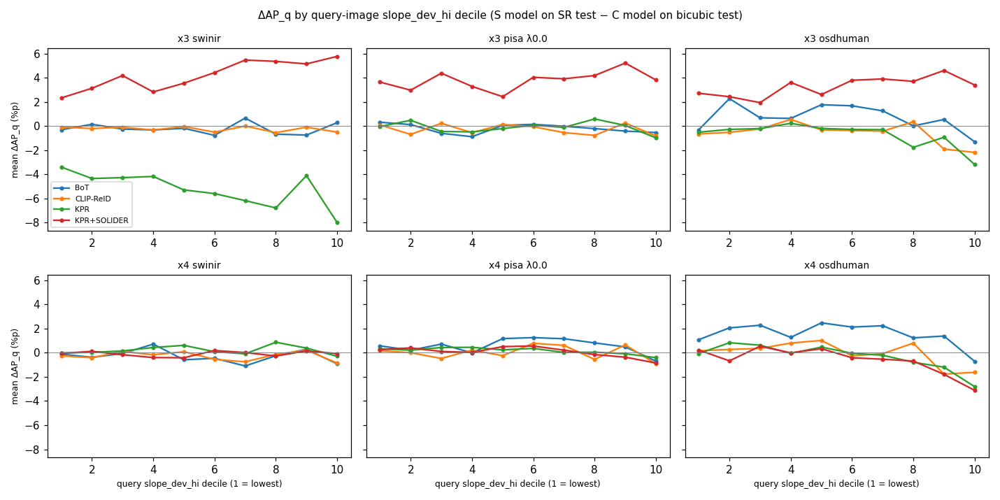

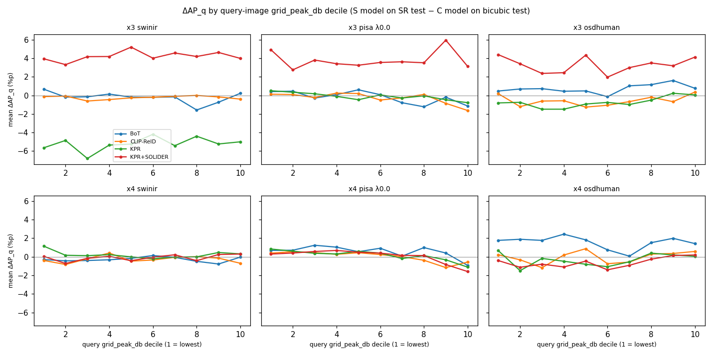

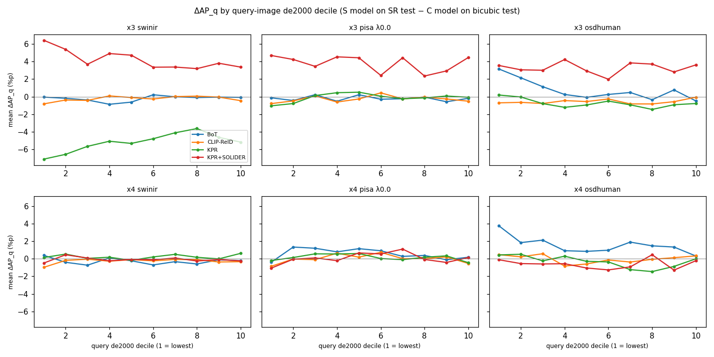

## 2d. 방법 단위 요약 (상관 계수 없음)

Stage 1 지표 평균(train 표본 2,250장, 신원 평균)과 Stage 2 ΔmAP(S 모델 + SR test − C 모델 + bicubic test, 판정). SR이 3개뿐이라 상관 계수는 내지 않았다.

| SR | 배율 | DINOv3 코사인↑ | PersonViT 코사인↑ | A-FINE 총점↓ | A-FINE 충실도↓ | A-FINE 자연스러움↓ | 저주파 일치도↑ | 고주파 추가량 dB(방향 없음) | 기울기 편차(0이 원본) | 격자 피크 dB↓ | ΔE2000↓ | ΔmAP BoT %p | ΔmAP CLIP-ReID %p | ΔmAP KPR %p | ΔmAP KPR+SOLIDER %p |
|---|---|---|---|---|---|---|---|---|---|---|---|---|---|---|---|
| swinir | 3 | 0.9513 | 0.993 | 45.022 | -1.8745 | -0.2224 | 0.9989 | 6.8129 | -3.9252 | 8.5544 | 0.0786 | -0.22 (inconclusive) | -0.24 (harmful) | -5.21 (harmful) | +4.22 (useful) |
| swinir | 4 | 0.9487 | 0.9932 | 45.2022 | -1.8683 | -0.1717 | 0.9988 | 6.6494 | -3.4237 | 12.7122 | 0.0729 | -0.28 (inconclusive) | -0.27 (harmful) | +0.22 (inconclusive) | -0.09 (inconclusive) |
| pisa λ0.0 | 3 | 0.7986 | 0.8986 | 12.0278 | -0.1438 | -0.5251 | 0.9823 | 10.272 | -3.6825 | 10.7821 | 2.2731 | -0.20 (inconclusive) | -0.27 (inconclusive) | -0.11 (inconclusive) | +3.79 (useful) |
| pisa λ0.0 | 4 | 0.7919 | 0.8995 | 10.4985 | -0.3024 | -0.4688 | 0.982 | 10.4502 | -3.5941 | 12.9304 | 2.2675 | +0.57 (useful) | +0.03 (inconclusive) | +0.16 (inconclusive) | +0.07 (inconclusive) |
| osdhuman | 3 | 0.6567 | 0.8037 | 0.4683 | 1.5346 | -0.9486 | 0.9751 | 15.3944 | -0.2313 | 11.2603 | 3.4857 | +0.73 (useful) | -0.57 (harmful) | -0.74 (harmful) | +3.27 (useful) |
| osdhuman | 4 | 0.6459 | 0.8027 | 0.0408 | 1.6197 | -0.894 | 0.9747 | 16.5747 | 0.3696 | 11.6476 | 3.4847 | +1.55 (useful) | -0.03 (inconclusive) | -0.32 (inconclusive) | -0.61 (harmful) |

## 3. 성공·실패 사례

SR 조건·배율마다 4개 모델 ΔAP_q 평균(4모델 모두 유효한 query)으로 가장 손해 본 20개와 이득 본 20개. 그림 한 줄: 원본 query(최근접 확대) | bicubic query | SR query | BoT C top-5 | BoT S top-5 | KPR+SOLIDER C top-5 | KPR+SOLIDER S top-5. C = bicubic 모델이 bicubic gallery에서, S = SR 모델이 SR gallery에서 찾은 결과. 테두리 초록 = 정답(같은 신원), 빨강 = 오답. Market 규칙대로 같은 신원·같은 카메라 gallery는 제외.

사례 20개의 query SR 이미지 지표 평균(전체 query별 값은 `results/stage2_analysis/cases.csv`).

| SR | 배율 | 구분 | 평균 ΔAP_q %p | DINOv3 코사인 | PersonViT 코사인 | A-FINE 총점 | 저주파 일치도 | ΔE2000 |
|---|---|---|---|---|---|---|---|---|
| swinir | 3 | 손해 | -21.9 | 0.953 | 0.9924 | 45.8 | 0.9991 | 0.07137 |
| swinir | 3 | 이득 | +20.0 | 0.9712 | 0.9941 | 48.13 | 0.9995 | 0.06672 |
| swinir | 4 | 손해 | -15.1 | 0.95 | 0.9929 | 46.37 | 0.9992 | 0.07294 |
| swinir | 4 | 이득 | +14.8 | 0.9459 | 0.9898 | 44.16 | 0.9991 | 0.06631 |
| pisa λ0.0 | 3 | 손해 | -20.1 | 0.7564 | 0.842 | 25.4 | 0.9783 | 2.176 |
| pisa λ0.0 | 3 | 이득 | +23.5 | 0.8266 | 0.9021 | 19.49 | 0.9837 | 2.182 |
| pisa λ0.0 | 4 | 손해 | -19.7 | 0.7836 | 0.8655 | 24.92 | 0.9811 | 2.072 |
| pisa λ0.0 | 4 | 이득 | +20.5 | 0.779 | 0.8842 | 9.793 | 0.9844 | 2.209 |
| osdhuman | 3 | 손해 | -32.8 | 0.5816 | 0.6618 | 3.103 | 0.9625 | 3.763 |
| osdhuman | 3 | 이득 | +31.6 | 0.6231 | 0.7607 | 1.983 | 0.9735 | 3.326 |
| osdhuman | 4 | 손해 | -35.7 | 0.561 | 0.62 | 0.04998 | 0.9661 | 3.556 |
| osdhuman | 4 | 이득 | +28.7 | 0.6368 | 0.7543 | 3.228e-18 | 0.9737 | 3.413 |

## 한계

- 사후 분석이며 Stage 2 판정과 별개다. 상관은 인과가 아니다.
- 다중 비교: 지표 10 × 설명 변수 2 × 모델 4 × 배율 2 × SR 3 = 480개 상관을 보정 없이 보고한다. 개별 CI가 0을 벗어나는 것만으로 의미를 두지 않는다.
- seed 1개: ΔAP_q에는 두 모델(S, C) 학습 변동이 그대로 들어 있다. 특히 KPR+SOLIDER ×3 bicubic 모델과 KPR ×3 swinir 모델은 약하게 수렴해 그 조합의 ΔAP_q 분포 전체가 한쪽으로 치우친다(`STAGE2_REPORT.md` 한계).
- query AP는 0~1 사이에 몰리고 동점(둘 다 AP 1)이 많아 ρ의 크기가 작게 나오기 쉽다. 동점은 중간 순위로 처리했다.
- 정답 gallery 지표 평균은 같은 신원·다른 카메라 이미지만(Market 규칙) 사용했다.
- train 표본은 2,250장(751명), test는 사람 이미지 전체(750명)로 표본 크기가 다르다. 두 분포의 차이는 데이터 분할(신원·장면 차이)의 영향을 포함한다.
- 기준선 재확인의 미세 차이(CLIP-ReID, KPR)는 GPU 종류(fp16·커널)에 따른 특징 차이이며 Stage 2 셀은 모두 같은 A100에서 추출했다.
- 사례 그림은 Claude가 열어 보지 않았다(수치로만 생성·검사).
